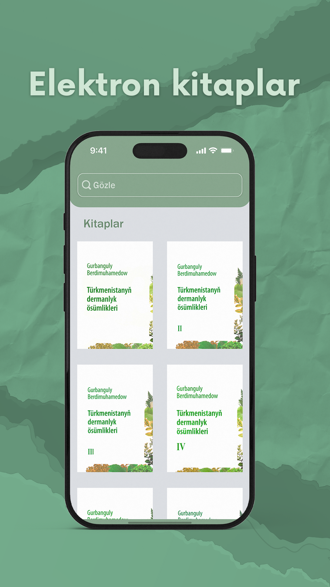

# Türkmenistanyň Dermanlyk Ösümlikleri

An Android application for exploring information about medicinal plants found in Turkmenistan. The app provides plant descriptions and related information in Turkmen, English, Russian, Japanese, and Spanish. It is designed as an offline reference for students and anyone interested in Turkmenistan's plant life.

  
  

## Features

- Browse medicinal plant information offline.
- Search and filter plant entries.
- View highlighted search results.
- Save entries for quick access.
- Switch between light and dark themes.
- Resize text with pinch gestures on plant information pages.
- Select and copy text.
- Use the app in five languages: Turkmen, English, Russian, Japanese, and Spanish.
- Ask the AI assistant questions about plant information.
- Recognize plants using the device camera.

## Download

The app is available on Google Play:

[Download Türkmenistanyň Dermanlyk Ösümlikleri](https://play.google.com/store/apps/details?id=com.medicine.kitaphana)

## Technologies

- Java
- Android Studio
- TensorFlow Lite
- CameraX
- Gemini API

## About the Content

The plant information is based on the book series *Türkmenistanyň Dermanlyk Ösümlikleri* by Gurbanguly Berdimuhamedow.

The app is intended for educational and reference purposes. It is not a substitute for professional medical advice, diagnosis, or treatment.
